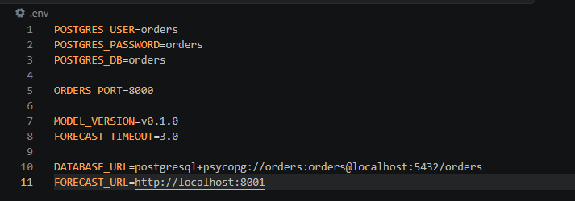
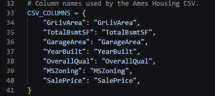
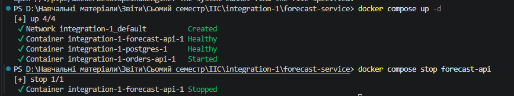
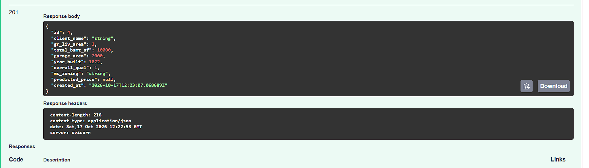
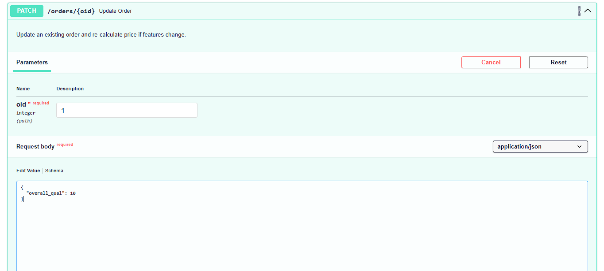
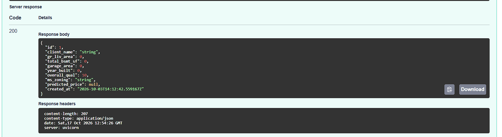

# Звіт з лабораторної роботи: Розширення та вдосконалення системи House Price Forecast & Orders API

**Виконав(ла):** [Мазур Юрій Сергійович, ФЕІ-41с]  
**Дисципліна:** [Інтеграція Інформаційних систем]  

---

## Мета роботи
Розширити функціональність існуючого мікросервісного застосунку для прогнозування вартості нерухомості. Вирішити архітектурну проблему залежності сервісів (graceful degradation), розширити операцію оновлення замовлень (PATCH) та впровадити коректну методологію оцінки моделі машинного навчання.

---

## Завдання 1. Дослідження та виправлення архітектурної проблеми

### Опис проблеми
Під час аналізу взаємодії між `orders-service` та `forecast-service` було виявлено проблему. Якщо сервіс прогнозування (`forecast-api`) стає недоступним (наприклад, контейнер зупинено), спроба створити нове замовлення через `orders-api` призводить до помилки. Це порушує принцип стійкості до відмов (graceful degradation), за яким замовлення мало б створюватися зі значенням `predicted_price: null`.

### Причини проблеми та внесені зміни
1. **Налаштування середовища:** У файлі `.env` (створеному з `.env.example`) були вказані адреси `localhost`, через що контейнери Docker не могли знайти один одного. Змінну `FORECAST_URL` було виправлено для використання внутрішньої мережі Docker.



2. **Проблема з даними (ValueError):** Під час збирання контейнера `forecast-api` виникала помилка невідповідності назв колонок. У файлі `model.py` словник `CSV_COLUMNS` було оновлено, щоб назви відповідали фактичному формату у файлі `ames_train.csv` (без пробілів: `GrLivArea`, `OverallQual` тощо).



3. **Обробка помилок (try/except):** Було проаналізовано код `orders-api` (`main.py`). У функції створення замовлення логіка перехоплення мережевих помилок (`httpx.ConnectError`, `httpx.TimeoutException`) вже була передбачена: при виникненні винятку генерується лог-попередження, а змінній `price` присвоюється значення `None`.

### Демонстрація роботи
Після налаштування системи було зупинено контейнер `forecast-api`. Запит на створення замовлення (`POST /orders`) успішно відпрацював, зберігши замовлення з `predicted_price: null`.



> ****

> *Зі скріншота зі Swagger UI (POST /orders), видно код відповіді 200/201 та тіло відповіді, в якому є рядок `"predicted_price": null`, а отже запит відпрацював успішно.*

---

## Завдання 2. Розширення операції PATCH

### Опис завдання
Початковий метод `PATCH /orders/{id}` дозволяв оновлювати лише поле `client_name`. Завдання полягало в тому, щоб додати можливість змінювати параметри нерухомості та автоматично оновлювати прогноз вартості при їх зміні.

### Внесені зміни
1. **Розширення Pydantic-схеми:** У файлі `schemas.py` до моделі `OrderUpdate` було додано опціональні поля для параметрів нерухомості (`gr_liv_area`, `total_bsmt_sf`, `garage_area`, `year_built`, `overall_qual`, `ms_zoning`).

**Фрагмент коду `schemas.py`:**
```python
class OrderUpdate(BaseModel):
    client_name: str | None = None
    gr_liv_area: float | None = None
    total_bsmt_sf: float | None = None
    garage_area: float | None = None
    year_built: int | None = None
    overall_qual: int | None = None
    ms_zoning: str | None = None
```
Оновлення логіки в main.py: Метод update_order було повністю переписано. Тепер він перевіряє, чи є в запиті поля, що впливають на ціну. Якщо так — формується словник payload (комбінація нових та існуючих даних), і виконується повторний запит до forecast-service. Логіка запиту обгорнута в try...except, щоб при недоступності forecast-service ціна просто ставала null (збереження graceful degradation).

**Фрагмент коду main.py (метод PATCH):**

```python
@app.patch(
    "/orders/{oid}",
    response_model=schemas.OrderRead,
)
def update_order(
    oid: int,
    data: schemas.OrderUpdate,
    db: Session = Depends(get_db),
):
    """Update an existing order and re-calculate price if features change."""
    order = crud.get_order(db, oid)

    if order is None:
        raise HTTPException(
            status_code=404,
            detail="Order not found.",
        )

    # Отримуємо словник з новими даними, які прислав клієнт
    update_data = data.model_dump(exclude_unset=True)

    # Перевіряємо, чи є в оновленні параметри, що впливають на ціну
    forecast_features = {
        "gr_liv_area", "total_bsmt_sf", "garage_area", 
        "year_built", "overall_qual", "ms_zoning"
    }
    needs_reforecast = any(feature in update_data for feature in forecast_features)

    if needs_reforecast:
        # Збираємо актуальні параметри: беремо нові, якщо є, інакше старі з БД
        payload = {
            "gr_liv_area": update_data.get("gr_liv_area", order.gr_liv_area),
            "total_bsmt_sf": update_data.get("total_bsmt_sf", order.total_bsmt_sf),
            "garage_area": update_data.get("garage_area", order.garage_area),
            "year_built": update_data.get("year_built", order.year_built),
            "overall_qual": update_data.get("overall_qual", order.overall_qual),
            "ms_zoning": update_data.get("ms_zoning", order.ms_zoning),
        }
        
        # Намагаємося отримати нову ціну (з graceful degradation)
        try:
            new_price = _request_prediction(payload)
            order.predicted_price = new_price
        except Exception as exc:
            logger.error("Forecast service is unavailable during update: %s", exc)
            order.predicted_price = None

    # Зберігаємо зміни в БД
    return crud.update_order(
        db,
        order,
        data,
    )
```
**Демонстрація роботи**




## Завдання 3. Коректна оцінка ML-моделі

### Опис проблеми

У початковій реалізації навчання в `train.py` метрики $R^2$ та $MAE$ розраховувалися на тих самих даних, на яких модель навчалася (*in-sample evaluation*). Такий підхід не давав змоги об'єктивно оцінити якість прогнозування на нових даних і міг створювати надто оптимістичне враження про модель.

### Внесені зміни

Для коректнішої оцінки було застосовано розбиття даних на навчальну та тестову вибірки (*train/test split*):

- датасет розділено у пропорції 80/20 за допомогою `train_test_split` з бібліотеки `sklearn`;
- модель навчалася на тренувальній вибірці (`X_train`);
- прогнозування та обчислення метрик виконувалися на тестовій вибірці (`X_test`).

### Фрагмент коду з `train.py`

Вставте сюди функцію `main()` з файлу `train.py`, у якій реалізовано розбиття даних на вибірки:

```python
def main() -> None:
    """Train the model, report metrics, and persist the artifact."""
    
    df = load_training_data()

    # 1. Виділяємо ознаки (X) та цільову змінну (y)
    X = df[NUM + CAT]
    y = df[TARGET]

    # 2. Розбиваємо дані: 80% на навчання, 20% на тест
    X_train, X_test, y_train, y_test = train_test_split(
        X, y, test_size=0.2, random_state=42
    )

    # Отримуємо пайплайн моделі
    model = train_model()
    
    # 3. ПЕРЕНАВЧАЄМО модель ТІЛЬКИ на тренувальній вибірці
    model.fit(X_train, y_train)

    # 4. Робимо прогноз ТІЛЬКИ на тестовій вибірці (нових даних для моделі)
    predictions = model.predict(X_test)

    # 5. Рахуємо метрики якості на тестовій вибірці
    r2 = r2_score(y_test, predictions)
    mae = mean_absolute_error(y_test, predictions)

    # Виводимо out-of-sample метрики
    print(
        f"[train] Ames out-of-sample: "
        f"R2={r2:.4f}, MAE={mae:.0f} USD"
    )

    ARTIFACTS.mkdir(
        parents=True,
        exist_ok=True,
    )

    artifact_path = ARTIFACTS / "model.pkl"

    joblib.dump(
        model,
        artifact_path,
    )

    print(
        f"[train] artifact persisted: {artifact_path}"
    )
```

### Порівняння результатів

|          Оцінювання          | $R^2$  |    $MAE$   |
|------------------------------|-------:|-----------:|
| До змін (*in-sample*)        | 0.7844 | 21 639 USD |
| Після змін (*out-of-sample*) | 0.7994 | 24 276 USD |

### Висновок

Оцінка на незалежній тестовій вибірці (*out-of-sample*) краще відображає якість моделі на нових даних. Зростання $MAE$ порівняно з попередньою оцінкою показує, що результат *in-sample* був оптимістичнішим. Нові метрики дають об'єктивнішу оцінку прогнозування.

### Демонстрація роботи


## Висновки

Під час виконання лабораторної роботи ми зіткнулися з низкою архітектурних та логічних проблем у мікросервісному застосунку. Зокрема, виявилося, що система мала жорстку залежність від сервісу прогнозування: його недоступність призводила до помилок і повної неможливості створення замовлень. Крім того, на початковому етапі збирання виникли труднощі через неправильні адреси у конфігурації середовища та невідповідність назв колонок у наборі даних. Функціонал оновлення замовлень був суттєво обмеженим, оскільки дозволяв змінювати лише ім'я клієнта. Окремою і дуже вагомою проблемою стала некоректна методологія оцінки моделі машинного навчання: метрики якості обчислювалися на тих самих даних, на яких модель навчалася, що приховувало можливе перенавчання.

Для подолання цих викликів ми налаштували правильну взаємодію між Docker-контейнерами та виправили обробку датасету. Ключовим архітектурним рішенням стало впровадження принципу стійкості до відмов (*graceful degradation*), завдяки якому сервіс замовлень тепер перехоплює мережеві помилки і продовжує працювати, зберігаючи замовлення з порожньою ціною при падінні сусіднього мікросервісу. Ми також розширили Pydantic-моделі та логіку PATCH-запитів, дозволивши редагувати параметри нерухомості з автоматичним запитом на перерахунок ціни. У частині машинного навчання ми кардинально змінили підхід до тестування, впровадивши розділення даних на навчальну та тестову вибірки у пропорції 80/20, що дозволило перевірити модель на абсолютно нових для неї даних.

У результаті виконання роботи ми навчилися проєктувати та вдосконалювати стійкі мікросервісні архітектури, які здатні безперебійно функціонувати навіть за умов часткової відмови окремих модулів. Ми здобули практичний досвід розширення REST API, гнучкого оновлення даних та керування маршрутизацією між сервісами. Крім того, ми на практиці засвоїли фундаментальне правило машинного навчання: тестування моделі виключно на незалежній вибірці (*out-of-sample*) є критично важливим кроком для отримання об'єктивних метрик якості та оцінки її готовності до використання у реальному *production*-середовищі.
