# Звіт з лабораторної роботи 2: Secret Management and User Authentication

**Виконав(ла):** [Мазур Юрій Сергійович, ФЕІ-41с]

---

## 1. Завдання 1: Secret Management and Service Exposure
Було налаштовано управління секретами через механізм Docker Compose Secrets. 
Пароль до бази даних та ключ підпису JWT винесено у файли `secrets/db_password` та `secrets/jwt_secret_key`. У файлі `docker-compose.yml` змінено спосіб передачі пароля до PostgreSQL (`POSTGRES_PASSWORD_FILE`). 
Сервіс `forecast-api` було прибрано з публічного доступу (видалено секцію `ports`), тепер він доступний лише всередині Docker-мережі.

**Тест T4 (Відсутність доступу до Forecast API ззовні):**
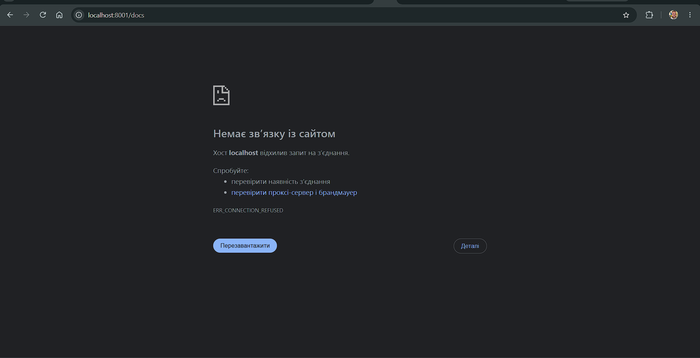

---

## 2. Завдання 2: User Registration and Authentication
У базу даних додано таблицю `users`. Реалізовано ендпоінти `/auth/register` (реєстрація), `/auth/login` (видача JWT-токена) та `/auth/me` (отримання профілю).
Паролі зберігаються у хешованому вигляді за допомогою бібліотеки `passlib` з алгоритмом `bcrypt`.
Всі ендпоінти `Orders API` (окрім `/health` та маршрутів авторизації) захищено за допомогою залежності `get_current_user`, яка перевіряє наявність валідного JWT-токена у заголовку `Authorization`.

**Тест T7/T8 (Спроба доступу без токена -> 401 Unauthorized):**
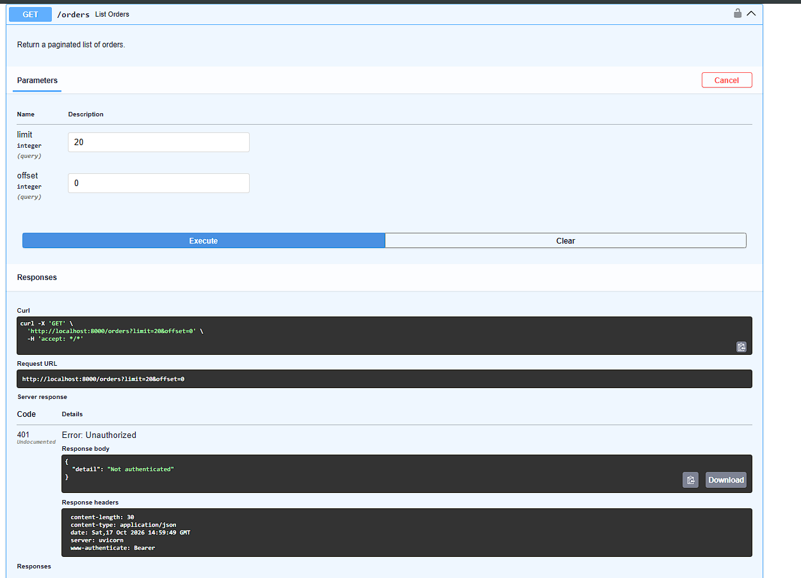

**Тест T5/T6 (Успішна авторизація та виклик /auth/me):**
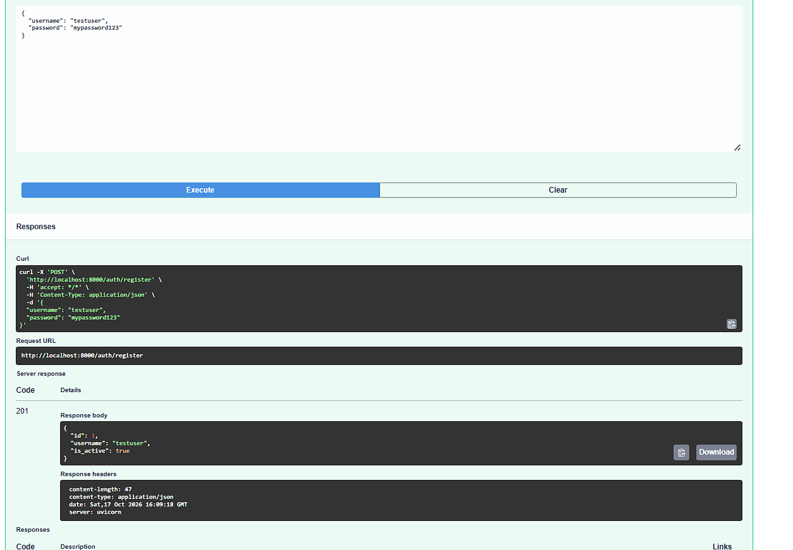
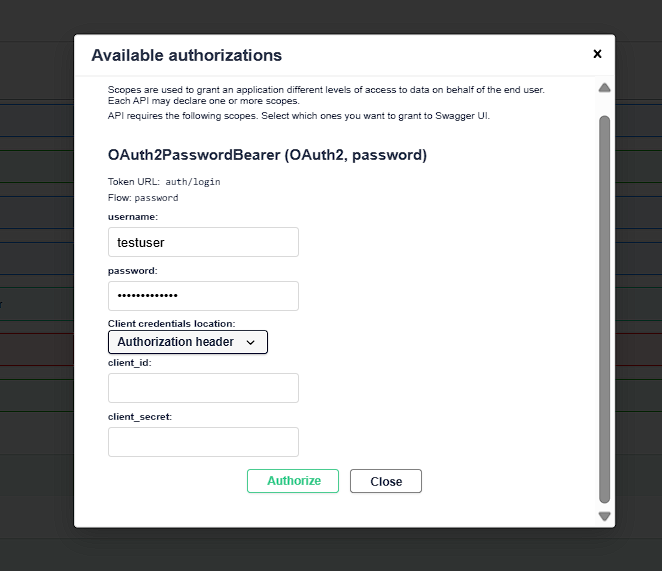
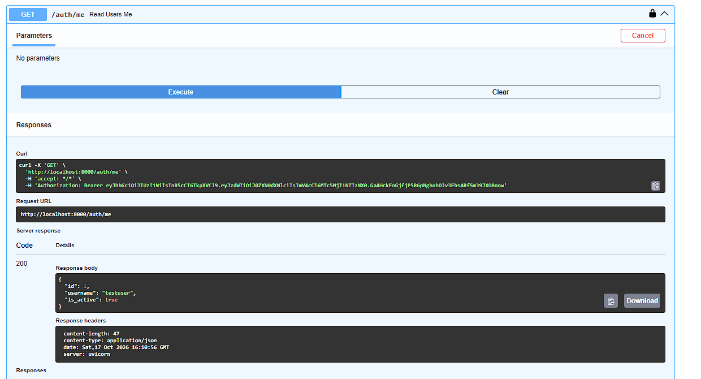

---

## 3. Завдання 3: Експерименти та тестування інтеграції

### Експеримент 1 (Test T11): Ротація ключа JWT
Після успішної авторизації ключ `jwt_secret_key` було змінено, а сервіс `orders-api` перезавантажено. Спроба виконати запит зі старим токеном призвела до помилки 401, оскільки підпис токена не співпав з новим ключем.
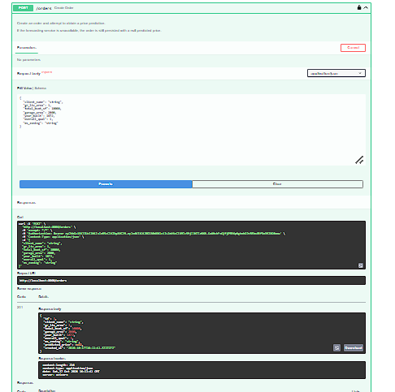
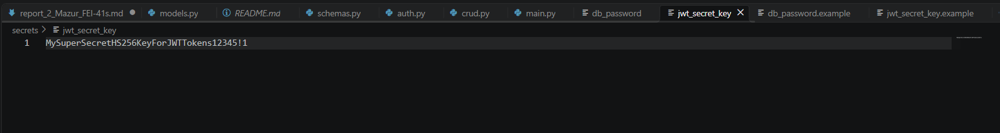
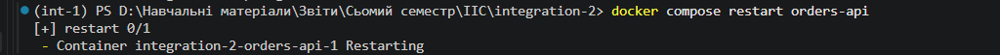
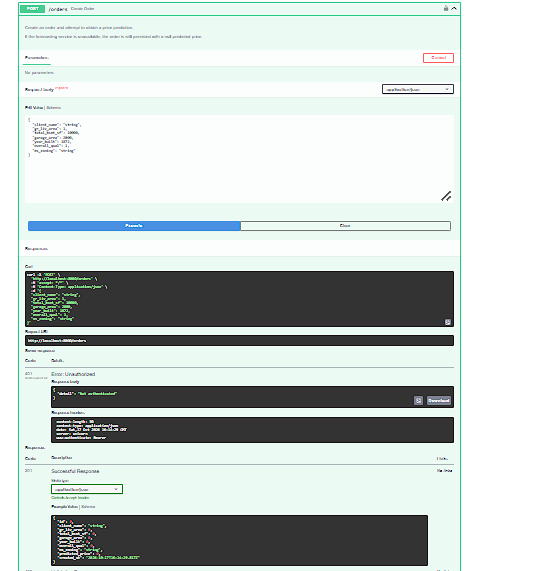

### Експеримент 2 (Test T2/T3): Відсутність секрету
При видаленні файлу секрету `db_password` система відмовилася запускатися (fail-fast behavior). На відміну від ситуації зі змінними середовища, де міг би передатися порожній рядок, Docker Compose одразу блокує запуск.
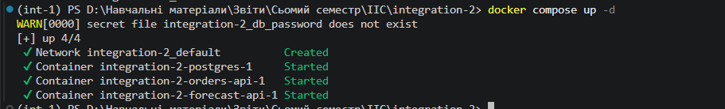

### Експеримент 3 (Test T12): Функціональна регресія
Функціонал graceful degradation збережено. При вимкненому `forecast-api` авторизований користувач успішно створює замовлення зі значенням `predicted_price: null`.
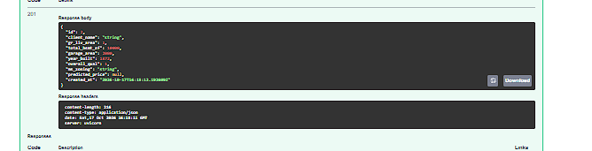

---
### Висновки 

Під час виконання другої лабораторної роботи ми зосередилися на впровадженні наскрізних механізмів безпеки у мікросервісну архітектуру: управлінні секретами та автентифікації користувачів. На початку ми зіткнулися з проблемою небезпечного зберігання конфіденційних даних (паролів до бази даних) у змінних середовища. Цю проблему було вирішено шляхом переходу на механізм Docker Compose Secrets, що дозволило безпечно монтувати паролі та криптографічні ключі як файли "тільки для читання", ефективно запобігаючи їх витоку. Крім того, ми посилили мережеву безпеку, повністю прибравши Forecast API із публічного доступу та зробивши Orders API єдиною захищеною точкою входу в систему.

У процесі додавання реєстрації та авторизації ми зіткнулися з технічними труднощами: застарілі бібліотеки хешування (passlib) виявилися несумісними з новою версією Python 3.14 у нашому контейнері. Ми успішно подолали цей виклик, швидко мігрувавши на сучасну бібліотеку pwdlib із підтримкою алгоритму Argon2. Це дозволило надійно хешувати паролі та налаштувати видачу JWT-токенів для доступу до системи. Проведені наприкінці експерименти довели надійність створеної архітектури: система відмовляється запускатися без секретів (fail-fast), коректно відхиляє старі токени після ротації ключів і при цьому зберігає стійкість до відмов (graceful degradation), дозволяючи авторизованим користувачам створювати замовлення навіть тоді, коли сервіс прогнозування лежить.

У результаті виконання цієї роботи ми здобули важливі практичні навички захисту мікросервісів. Ми навчилися правильно розділяти звичайну конфігурацію та секрети, реалізовувати автентифікацію без збереження стану (stateless) за допомогою JWT і OAuth 2.0, безпечно зберігати паролі у базі даних, а також діагностувати й оперативно вирішувати конфлікти залежностей у сучасних контейнеризованих застосунках.
## 4. Відповіді на контрольні запитання

**1. List at least four channels through which a secret passed as an environment variable may be disclosed.**
Через команду `docker inspect`, через файл конфігурації `docker compose config`, через файлову систему процесу `cat /proc/<pid>/environ`, та через історію команд оболонки shell (або логи CI/CD).

**2. Classify the following data as configuration or secrets:**
* **Configuration:** `MODEL_VERSION`, `FORECAST_TIMEOUT`, `POSTGRES_USER`, `ACCESS_TOKEN_EXPIRE_MINUTES`. Ці дані не становлять загрози безпеці у разі їх розголошення.
* **Secrets:** `db_password`, `jwt_secret_key`. Ці дані використовуються для аутентифікації або криптографії, і їх витік дозволить зловмиснику отримати несанкціонований доступ.

**3. State the differences between the Compose secrets mechanism and Docker secrets in Swarm mode.**
У звичайному Compose секрети — це просто локальні файли, які монтуються у контейнер. У Swarm режимі секрети шифруються у лозі Raft, безпечно передаються між вузлами кластера через TLS і не зберігаються на диску у відкритому вигляді.

**4. Explain why modification of the db_password secret does not change the password of an initialized PostgreSQL instance, and describe a safe rotation procedure.**
Docker-образ PostgreSQL читає пароль (змінну середовища або файл) лише один раз — під час первинної ініціалізації бази даних (створення тому). При наступних запусках він ігнорує ці змінні.
*Безпечна ротація (Dev):* Зупинити БД, видалити том (втрата даних), змінити секрет, запустити наново.
*Безпечна ротація (Prod):* Зайти всередину працюючого контейнера, змінити пароль SQL-командою `ALTER USER`, потім оновити файл секрету і перезапустити клієнтські мікросервіси.

**5. Justify the use of bcrypt or Argon2id instead of SHA-256 for password storage; define salt and work factor.**
SHA-256 — це швидкий алгоритм загального призначення, який легко піддається брутфорсу (перебору). Bcrypt є спеціальним повільним алгоритмом. *Salt* (сіль) — це випадковий рядок, що додається до пароля перед хешуванням, щоб запобігти використанню "райдужних таблиць". *Work factor* — це параметр, що визначає кількість ітерацій хешування (штучне сповільнення алгоритму).

**6. Describe the structure of a JWT and explain the effect of modifying the payload on the signature.**
JWT складається з трьох частин, розділених крапкою: Header, Payload (дані/claims) та Signature (підпис). Усі частини закодовані в Base64URL. Якщо змінити хоча б один символ у Payload, підпис перестане бути валідним, оскільки він розраховується на основі Header, Payload та секретного ключа.

**7. Define the alg: none and algorithm confusion attacks and state how the implementation prevents them.**
*alg: none attack:* Зловмисник змінює алгоритм у заголовку на "none" і прибирає підпис, сподіваючись, що сервер прийме токен без перевірки.
*Algorithm confusion:* Зловмисник змінює алгоритм з асиметричного (RS256) на симетричний (HS256).
Впровадження у нашому коді запобігає цьому шляхом явного вказування очікуваного алгоритму під час декодування: `algorithms=["HS256"]`.

**8. Explain the semantics of the 401 status code and the purpose of the WWW-Authenticate header.**
Код `401 Unauthorized` означає, що для доступу потрібна ідентифікація (відсутній або невалідний токен). Заголовок `WWW-Authenticate` (наприклад, з параметром `Bearer`) інструктує клієнта (або браузер), який саме тип аутентифікації очікує сервер для повторної спроби.

**9. Explain the effect of jwt_secret_key rotation on previously issued tokens.**
Після заміни ключа (ротації) сервер розраховуватиме новий підпис під час перевірки існуючих токенів. Оскільки ключ змінився, розрахований підпис не співпаде з підписом у токені, і сервер відхилить його, вимагаючи повторної авторизації.

**10. Justify why the login endpoint shall return an identical error message for an unknown username and an incorrect password.**
Це робиться для запобігання атаці "User Enumeration" (Перебір користувачів). Якби повідомлення відрізнялися, зловмисник міг би перевіряти, чи існує певний логін у системі, ще до того, як почне підбирати пароль.

**11. Justify the public accessibility of GET /health and the non-publication of the Forecast API.**
`/health` має бути публічним, щоб балансувальники навантаження або системи моніторингу (наприклад, оркестратори) могли перевіряти статус сервісу без надання їм токенів. Forecast API не публікується назовні для того, щоб зменшити площу атаки: всі запити повинні проходити виключно через Orders API, де здійснюється перевірка прав доступу (аутентифікація).

**12. Explain the statelessness of JWT authentication and its consequence for token revocation.**
JWT є stateless (без стану) — сервер не зберігає токени у базі даних і не перевіряє їх наявність. Він лише математично перевіряє підпис. Це означає, що сервер не може миттєво відкликати (скасувати) токен до його природного закінчення терміну дії (claim `exp`), якщо не реалізувати додаткову логіку з "чорними списками" токенів.