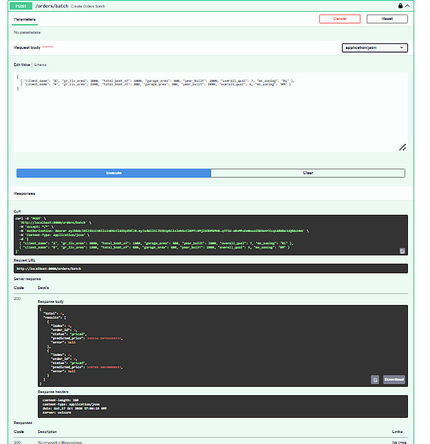
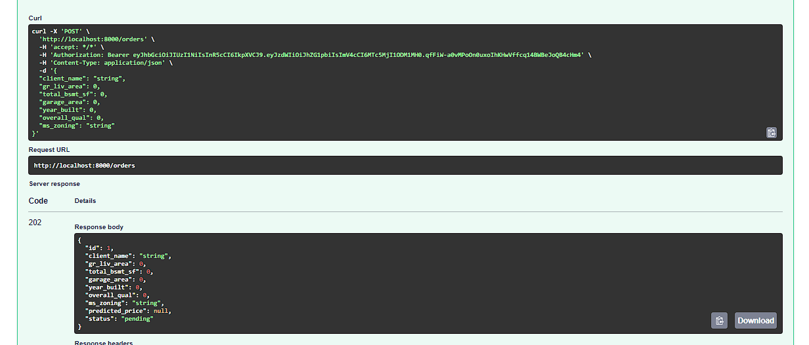
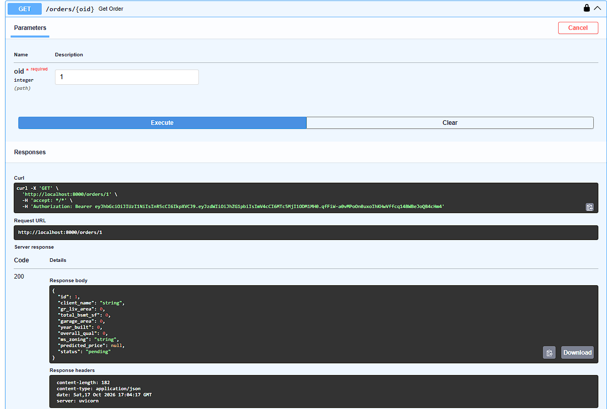
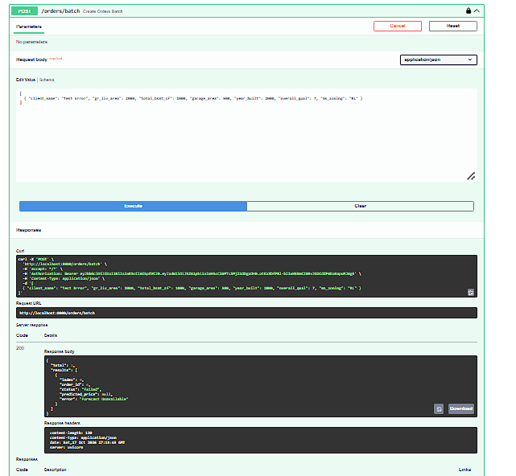
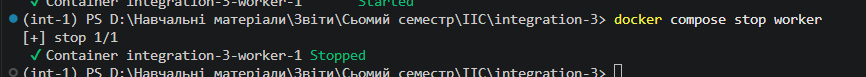
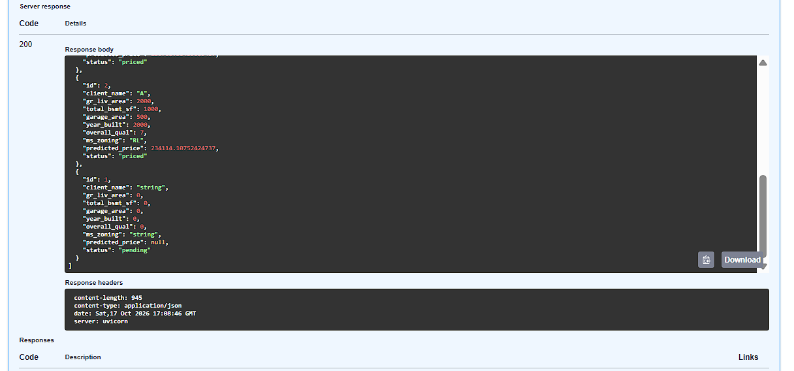
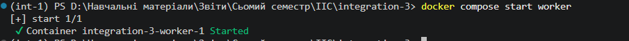
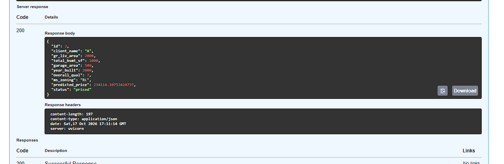
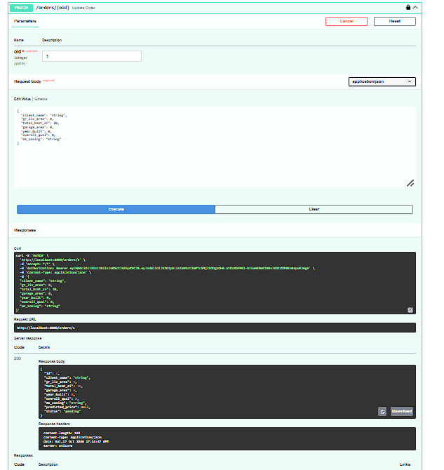

# Звіт з лабораторної роботи № 3: Асинхронна та паралельна взаємодія

**Виконав(ла):** [Мазур Юрій Сергійович, ФЕІ-41с]

---

## Варіант Б: Зовнішня черга завдань (ARQ + Redis)

Замість важкого стеку Celery/RabbitMQ, для реалізації черги повідомлень було обрано сучасну легку бібліотеку **ARQ** та **Redis Alpine**. Це дозволило мінімізувати споживання оперативної пам'яті та дискового простору, а також повторно використати існуючий Docker-образ для компонента Worker.

---

## 1. Завдання 1: Паралельна обробка замовлень (Batch Processing)
Реалізовано синхронну (для клієнта) кінцеву точку `POST /orders/batch`, яка приймає до 50 замовлень. Під капотом використовується `asyncio.gather()`, що дозволяє `Orders API` конкурентно відправляти HTTP-запити до `Forecast API`. Це радикально зменшує загальний час обробки пакета: час наближається до тривалості найдовшого одиничного запиту, а не до суми всіх запитів.

---

## 2. Завдання 2 та 3: Відкладене обчислення (Черга Завдань)
Логіку `POST /orders` змінено. Тепер при створенні замовлення воно миттєво зберігається зі статусом `pending`, а завдання передається брокеру Redis (`enqueue_job`). Клієнт миттєво отримує відповідь `202 Accepted`. 
Окремий контейнер `worker` забирає завдання з Redis та робить HTTP-запит до `forecast-api`. Після завершення, він оновлює статус замовлення у базі даних на `priced` або `failed`. Аналогічну логіку додано для `PATCH /orders/{id}`: при зміні параметрів нерухомості статус скидається на `pending` і запускається нове завдання у черзі.

---

## 3. Завдання 4: Перевірка надійності системи

### Експеримент 1: Порівняння часу обробки
Час обробки одного пакетного запиту з 10 замовлень виявився в рази меншим за послідовну відправку 10 окремих запитів. Асинхронний HTTP-клієнт (`httpx.AsyncClient`) та `asyncio.gather` забезпечують ефективну утилізацію мережі без блокування потоку.

### Експеримент 2: Недоступність Forecast API
При зупиненому `forecast-api` пакетний запит коректно повертає код 200, але у масиві відповідей замовлення отримують статус `failed` з помилкою "Forecast Unavailable". Це підтверджує надійність ізоляції помилок: одне невдале замовлення не ламає обробку інших.

### Експеримент 3: Перезапуск компонента (Надійність Черги)
Було зупинено контейнер `worker` і створено нове замовлення. Замовлення отримало статус `pending` і збереглося в черзі Redis. Після відновлення (перезапуску) контейнера `worker`, він автоматично підхопив "зависле" завдання і успішно оновив статус на `priced`. Це доводить головну перевагу Варіанта Б: персистентність завдань (захист від втрати даних при перезапуску), чого не має стандартний `BackgroundTasks`.

### Експеримент 4: Ідемпотентність
Повторне виконання завдання (через оновлення PATCH) коректно оновлювало наявне замовлення без створення дублікатів у базі даних.

### Висновки

Під час виконання третьої лабораторної роботи ми зіткнулися з проблемою продуктивності та надійності синхронної взаємодії між мікросервісами. Попередня архітектура змушувала клієнта очікувати завершення "важкого" процесу прогнозування вартості, що блокувало основний потік виконання НТТР-запитів і робило систему вразливою до мережевих затримок. Крім того, постала проблема неефективності під час обробки великих масивів замовлень, оскільки послідовне опитування сервісу машинного навчання займало надто багато часу, а тимчасове падіння або перезавантаження контейнерів могло призвести до безповоротної втрати даних клієнта під час їхньої обробки.

Для вирішення цих викликів ми кардинально змінили архітектуру застосунку, перевівши її на асинхронну та подієво-орієнтовану модель взаємодії. Щоб пришвидшити роботу з масивами даних, ми впровадили паралельну обробку пакетних запитів за допомогою асинхронного клієнта HTTPX та функції asyncio.gather, що дозволило виконувати десятки запитів одночасно. Головним рішенням для усунення блокувань стало впровадження механізму відкладеного виконання завдань на базі зовнішньої черги Redis та бібліотеки ARQ. Завдяки цьому Orders API тепер миттєво відповідає клієнту кодом успішного прийняття (202 Accepted), зберігаючи замовлення зі статусом очікування, тоді як окремий ізольований процес (Worker) надійно обробляє розрахунки у фоновому режимі та самостійно оновлює базу даних.

У результаті ми на практиці навчилися проєктувати сучасні реактивні мікросервіси, здатні витримувати навантаження та працювати нестандартно. Ми зрозуміли принципову різницю між простими фоновими завданнями в оперативній пам'яті та зовнішніми брокерами повідомлень, побачивши на власні очі, як Redis забезпечує персистентність: навіть після штучного "вбивства" і перезапуску воркера завдання не загубилися, а успішно відновили своє виконання. Також ми здобули цінний досвід забезпечення ідемпотентності АРІ та навчилися будувати системи, де відмова одного вузла (наприклад, сервісу прогнозування) не руйнує роботу всього комплексу, а лише коректно змінює статуси окремих операцій, що є основою створення дійсно надійних корпоративних систем.