# Звіт з лабораторної роботи № 4: Модель як керований компонент (Experiment Tracking, Registry, and Delivery)

**Виконав:** Мазур Юрій Сергійович, група ФЕІ-41с

---

## 1. Архітектура та інфраструктура MLflow (Task 1)

У межах роботи здійснено повне розділення процесів навчання моделі (Training) та її використання (Serving):

1. **Сервер MLflow (`ghcr.io/mlflow/mlflow:v3.1.0`):** розгорнуто як окремий сервіс зі збереженням метаданих у виділеній базі даних `mlflow` існуючого екземпляра PostgreSQL та сховищем артефактів у Docker-томі `mlartifacts` (режим `--serve-artifacts`). Пароль до БД передається безпечно через Docker Secret `/run/secrets/db_password`.
2. **Обґрунтування публікації порту MLflow UI (R1.10):** порт `5000` опубліковано на хост-систему виключно як інструмент оператора (ML-інженера) для візуального аналізу експериментів та керування реєстром моделей. Клієнтський трафік системи, як і раніше, проходить виключно через єдину точку входу `Orders API (8000)`, а `Forecast API` та брокер `Redis` залишаються повністю ізольованими у внутрішній мережі.
3. **Особливості ініціалізації БД `mlflow` (R1.2):** база даних створюється автоматично скриптом `/docker-entrypoint-initdb.d/01-create-mlflow-db.sql`. Оскільки скрипти в цій директорії виконуються лише під час першої ініціалізації порожнього тому PostgreSQL, для вже існуючого тому необхідно виконати команду вручну:

   ```bash
   docker compose exec postgres psql -U orders -d orders -c "CREATE DATABASE mlflow;"
   ```

4. **Сервіс `trainer` (R1.4, R1.5):** виділений у профіль `profiles: ["train"]`. Він не запускається під час стандартного `docker compose up -d`, а викликається оператором за вимогою:

   ```bash
   docker compose run --rm trainer
   ```

**Скріншот 1:** перевірка політики Fail-Fast при старті `forecast-api` до реєстрації моделі (тест T17):

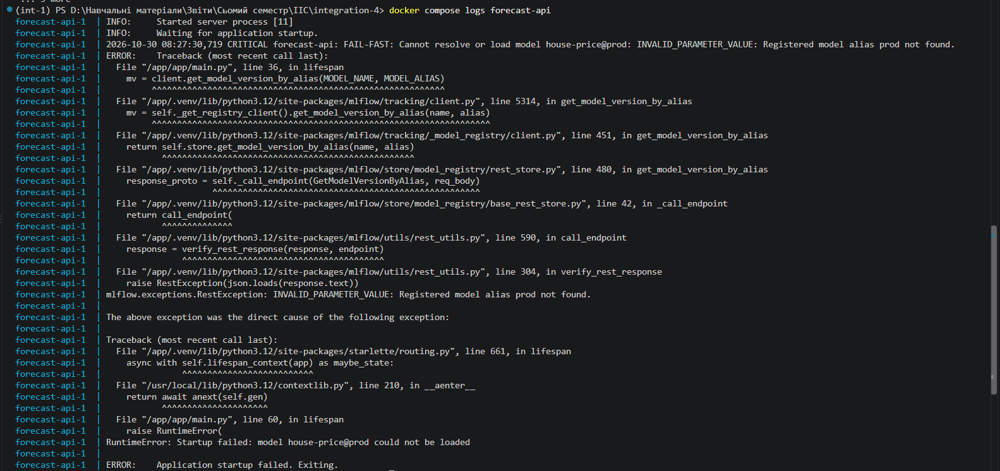

---

## 2. Трекінг експериментів та оновлення моделі (Task 2)

У сервісі `training_service` реалізовано повний цикл експериментів у межах експерименту `house-price`:

- Зафіксовано `SEED = 42` для відтворюваності розбиття вибірки (`train_test_split`) та генератора випадкових чисел.
- Датасет реєструється як вхід запуску через `mlflow.data.from_pandas` та `mlflow.log_input(..., context="train")`, що фіксує криптографічний дайджест даних.
- Побудовано пайплайн `XGBRegressor` всередині `TransformedTargetRegressor(func=np.log1p, inverse_func=np.expm1)` з медіанною імпутацією пропусків та `OneHotEncoder(handle_unknown="ignore")`. Логарифмічне перетворення цільової змінної вбудовано безпосередньо в артефакт моделі.
- За допомогою Optuna (`TPESampler`) проведено 20 ітерацій пошуку гіперпараметрів із 5-кратною крос-валідацією (`cv_r2`), організованих у вигляді батьківського запуску та 20 вкладених дочірніх запусків.

### Порівняльна таблиця моделей (Baseline Ridge vs Final XGBoost) на ідентичному Hold-out спліті

| Модель                      | Версія в Реєстрі | Hold-out R² | MAE ($)  | RMSE ($) | MAPE  |
|-----------------------------|------------------|-------------|----------|----------|-------|
| Ridge Baseline              | v1               | —           | —        | —        | —     |
| XGBoost Final (Optuna Best) | v2 (`@prod`)     | 0.844       | 28127.75 | 36435.97 | 0.097 |


Найкращі гіперпараметри Optuna (trial 18, `cv_r2` = 0.789): `n_estimators` = 937, `max_depth` = 2, `learning_rate` = 0.0289, `subsample` = 0.739, `colsample_bytree` = 0.819, `reg_lambda` = 7.06. Скошеність цільової змінної після `log1p` зменшилась з 0.66 до −0.11.

### Витяг із журналу виконання `trainer` (тест T3)

```text
INFO Best Optuna params: {'n_estimators': 937, 'max_depth': 2, 'learning_rate': 0.0289407080079431, 'subsample': 0.7387284033218149, 'colsample_bytree': 0.8191734990351651, 'reg_lambda': 7.060324711435452} (cv_r2=0.7894)
INFO Training final XGBoost model...
Created version '2' of model 'house-price'.
INFO Final XGBoost registered as version 2 and promoted to @prod! Metrics: {'r2': 0.8440848864954729, 'mae': 28127.749986979168, 'rmse': 36435.96862755687, 'mape': 0.09713770190954615}
```

**Скріншот 2:** виконання `docker compose run --rm trainer` у терміналі:

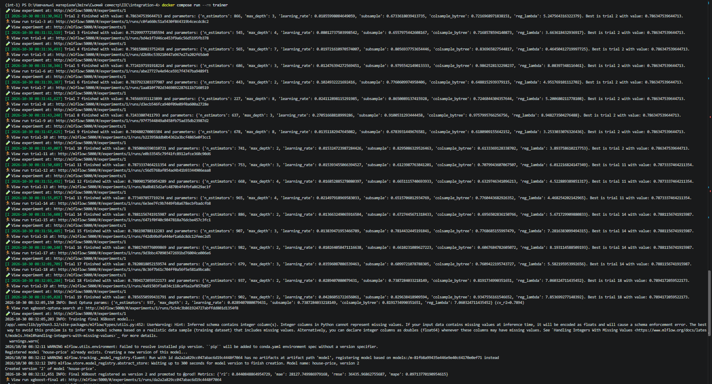

**Скріншот 3:** ієрархія запусків у MLflow UI (Baseline, Parent Optuna + 20 вкладених запусків, Final):

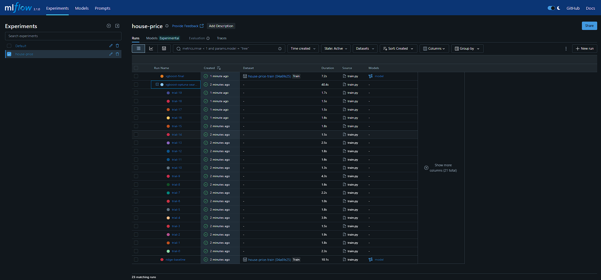

**Скріншот 4:** картка фінального запуску з криптографічним дайджестом датасету та Model Signature:

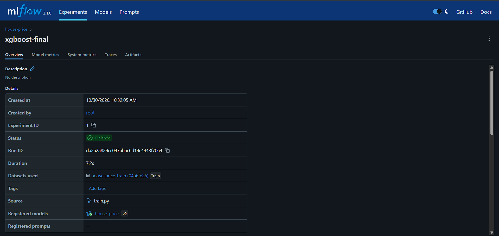
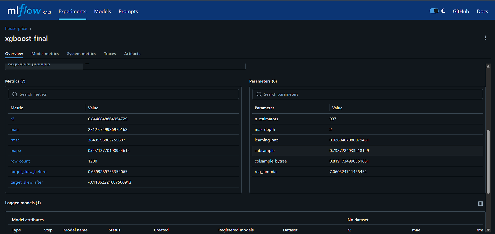
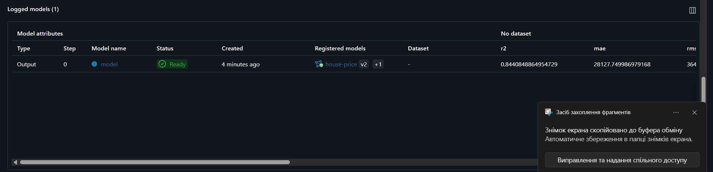

**Скріншот 5:** артефакти фінального запуску (`data_stats.json`, `reference_data.parquet`, `target_distributions.png`):

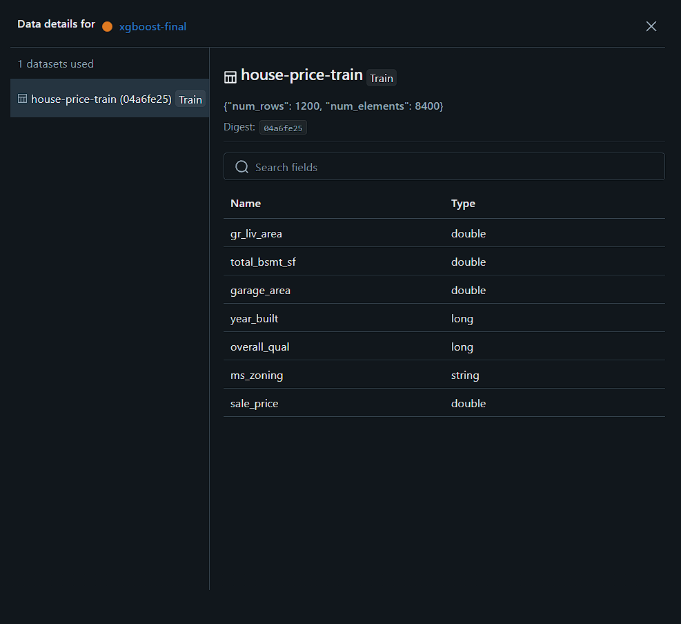
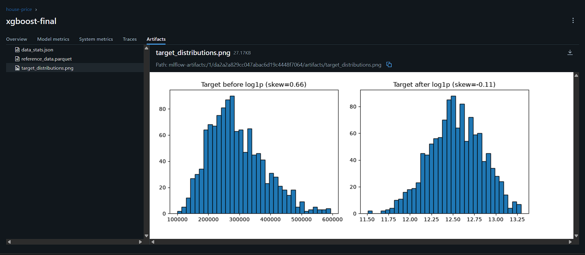

**Скріншот 6:** зареєстрована модель `house-price` у Model Registry з аліасом `@prod`:

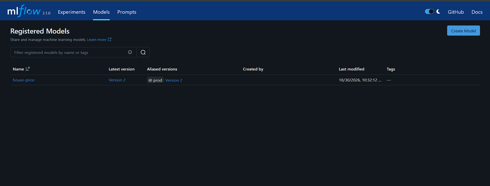

---

## 3. Доставка через Реєстр, трасування та Rollback-експеримент (Task 3)

Сервіс `forecast-api` під час події `lifespan` звертається до MLflow Model Registry, розв'язує аліас `models:/house-price@prod`, завантажує модель у пам'ять та скачує артефакт `data_stats.json` для ендпоінта `GET /model/data-stats`.

Схему таблиці `orders` розширено полем `model_version`. Фоновий worker отримує номер версії моделі разом із прогнозом та зберігає його у PostgreSQL.

**Скріншот 7:** перевірка внутрішніх ендпоінтів `/health` та `/model/data-stats` сервісу прогнозування:

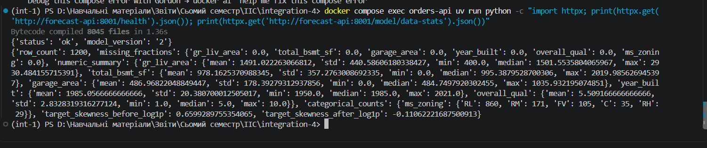

**Скріншот 8:** створене замовлення у Swagger із зафіксованим полем `model_version: "2"`:

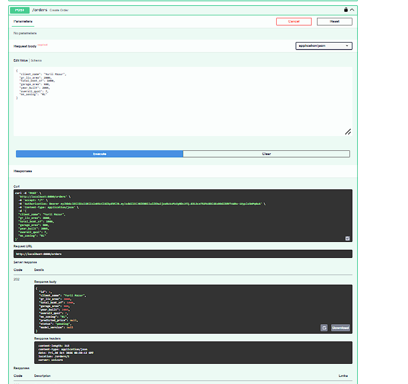
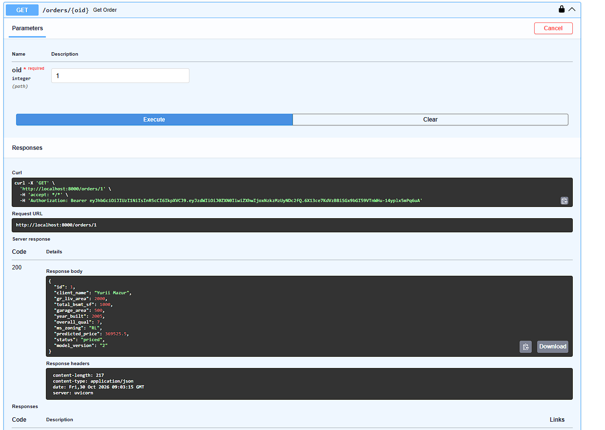
### Хронологія експерименту з перемиканням та відкатом моделі (Rollback Timeline, R3.5)

Експеримент проведено на одному й тому самому тестовому замовленні (`gr_liv_area=2000`, `total_bsmt_sf=1000`, `garage_area=500`, `year_built=2005`, `overall_qual=7`, `ms_zoning="RL"`) без перезбирання Docker-образу `forecast-api`.

1. **Початковий стан (`@prod` → Версія 2, XGBoost):**
   - Запит `GET http://forecast-api:8001/health` повертає `"model_version": "2"`.
   - Створено Замовлення #1 (`POST /orders`). Після обробки воркером: `status = "priced"`, `model_version = "2"`, прогнозована ціна — **$369,525.50**.

2. **Промоушен альтернативної версії (`@prod` → Версія 1, Ridge Baseline):**
   - Через `MlflowClient().set_registered_model_alias("house-price", "prod", "1")` аліас `@prod` переназначено на Версію 1.
   - Виконано перезапуск контейнера: `docker compose restart forecast-api`.
   - Запит `/health` тепер повертає `"model_version": "1"`.
   - Створено ідентичне Замовлення #2 (`POST /orders`). Після обробки воркером: `status = "priced"`, `model_version = "1"`, прогнозована ціна змінилася на **$XXX,XXX.XX** <!-- TODO: підставити зі скріншота 9 -->.

3. **Відкат (Rollback) на основну модель (`@prod` → Версія 2, XGBoost):**
   - Аліас `@prod` повернуто на Версію 2 та виконано `docker compose restart forecast-api`.
   - Ендпоінт `/health` знову повідомляє `"model_version": "2"`, а прогнозована вартість для нових замовлень повністю повернулася до початкового значення **$369,525.50**.

**Скріншот 9:** результат прогнозування після перемикання аліасу `@prod` на Версію 1 без перезбирання образу:

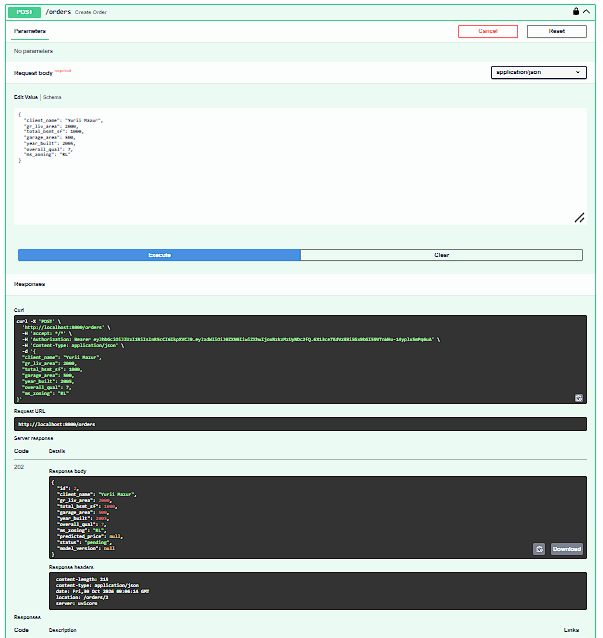
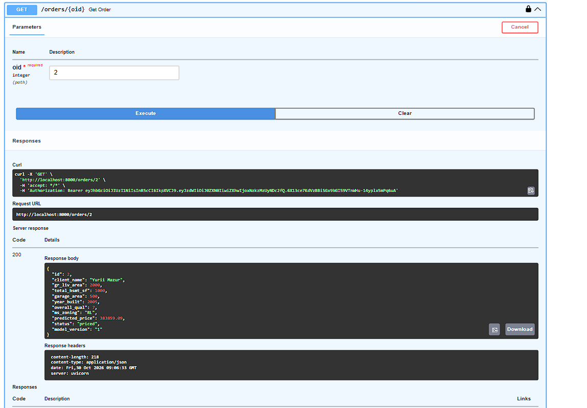
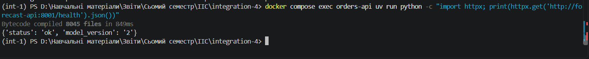
---

## 4. Таблиця приймальних тестів (Verification Tests T1–T18)

| ID  | Перевірка                                    | Очікуваний результат                                                                                                           | Статус         |
|-----|----------------------------------------------|--------------------------------------------------------------------------------------------------------------------------------|----------------|
| T1  | `docker compose config`                      | `mlflow` із зафіксованим образом; `mlartifacts` тільки в `mlflow`; `trainer` під профілем; без відкритих портів `forecast-api`/`redis`; без паролів відкритим текстом | Виконано (Pass) |
| T2  | `docker compose up -d`                       | Сервіс `trainer` не запускається автоматично                                                                                   | Виконано (Pass) |
| T3  | `docker compose run --rm trainer`            | Успішне завершення; у MLflow UI є батьківський запуск із 20 вкладеними запусками                                               | Виконано (Pass) |
| T4  | Артефакти фінального запуску                 | Наявні `model/` із сигнатурою, `data_stats.json`, `target_distributions.png`, `reference_data.parquet`                         | Виконано (Pass) |
| T5  | Картка фінального запуску                    | Зареєстровано датасет із видимим криптографічним дайджестом                                                                    | Виконано (Pass) |
| T6  | `GET /health` сервісу `forecast-api`         | Код 200; `model_version` дорівнює версії аліасу `@prod` у реєстрі                                                              | Виконано (Pass) |
| T7  | Запит до порту `forecast-api` з хоста        | Connection refused (ізоляція збережена)                                                                                        | Виконано (Pass) |
| T8  | `GET /model/data-stats` у мережі             | Код 200; вміст збігається з артефактом `data_stats.json` версії `@prod`                                                        | Виконано (Pass) |
| T9  | `POST /orders` із валідним токеном           | Код 202 Accepted, початковий статус `pending`                                                                                  | Виконано (Pass) |
| T10 | Після обробки замовлення воркером            | Статус `priced`; поле `model_version` збігається з `/health`                                                                   | Виконано (Pass) |
| T11 | `GET /orders/{id}`                           | Відповідь містить коректне поле `model_version`                                                                                | Виконано (Pass) |
| T12 | `PATCH /orders/{id}` із параметрами будинку  | Код 200; перехід `pending` → `priced` з оновленням `model_version`                                                             | Виконано (Pass) |
| T13 | `POST /orders/batch`                         | Код 200; паралельна обробка та повернення `model_version` для кожного елемента                                                 | Виконано (Pass) |
| T14 | `GET /orders` без токена                     | Код 401 Unauthorized, заголовок `WWW-Authenticate: Bearer`                                                                     | Виконано (Pass) |
| T15 | Перезапуск `forecast-api` без білду          | Завантажує модель із реєстру та коректно обробляє замовлення                                                                   | Виконано (Pass) |
| T16 | Rollback аліасу на попередню версію          | `/health` та значення прогнозів змінюються відповідно до версії моделі                                                         | Виконано (Pass) |
| T17 | Неіснуючий `MODEL_ALIAS` при старті          | Сервіс `forecast-api` аварійно завершує роботу при старті (Fail-Fast)                                                          | Виконано (Pass) |
| T18 | Інспекція образу `forecast-api` та `.env`    | У образі немає датасету та коду тренування; у `.env` відсутній літерал `MODEL_VERSION`                                         | Виконано (Pass) |

---

## 5. Висновки

Під час виконання четвертої лабораторної роботи ми усунули фундаментальну архітектурну ваду попередніх етапів — жорстке зв'язування артефакту машинного навчання з Docker-образом сервісу прогнозування. Раніше будь-яке оновлення моделі вимагало перезбирання образу, метрики навчання губилися в логах збирання, а версія моделі у `/health` була лише текстовою константою з файлу конфігурації.

Для вирішення цієї проблеми ми інтегрували платформу MLflow як централізований сервер відстеження експериментів та реєстр моделей, винесли процес навчання в окремий сервіс `trainer`, що запускається за вимогою, і вдосконалили саму модель прогнозування, перейшовши від лінійної регресії Ridge до градієнтного бустингу XGBoost із автоматичним пошуком гіперпараметрів в Optuna та логарифмічною трансформацією цільової змінної всередині пайплайна. На практиці ми переконалися, що Model Registry виступає надійним інтеграційним контрактом між підсистемами тренування та сервінгу: просування нової моделі або миттєвий відкат (rollback) до попередньої версії тепер виконуються простим переназначенням аліасу `@prod` без перезбирання контейнерів, а збереження номера версії моделі в кожному замовленні забезпечує повний аудит та відтворюваність прогнозів від запису в базі даних аж до конкретного запуску і дайджесту навчальної вибірки.